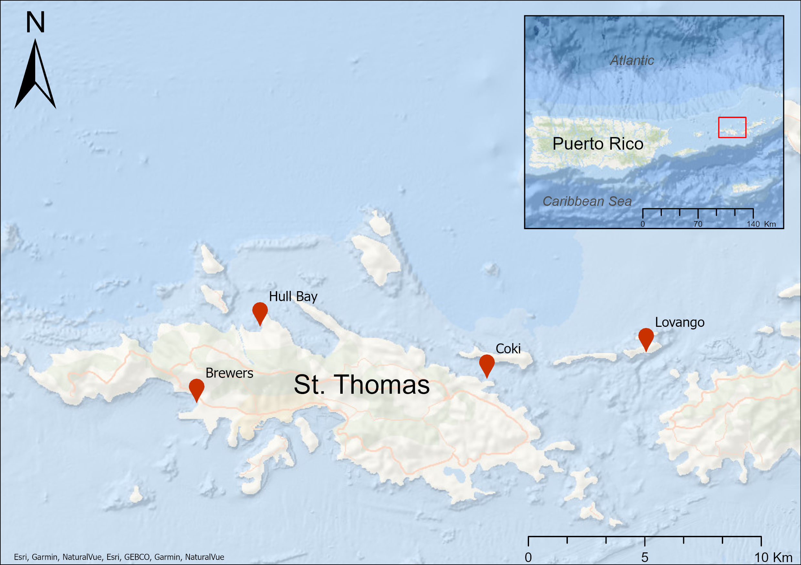

# Data Table
*Below is a list of all fish specimens collected as well as their respecrtive dates, locations, and methods of collection. I focused on collecting 20 specimens from each species and derived my species list from a previous paper, [@cook2015blood], which sampled a broader range of fish species in the Caribbean. I focused on collecting species that were found to harbor apicomplexan infections in Cook's study*

```{r}
#| label: load-csv
#| echo: false
#| message: false

library(readr)
library(knitr)
library("DT")
library(tidyverse)

# Read the CSV file (adjust path as needed)
my_data <- read_csv("../Data/Thesis_data.csv")

datatable(my_data, options = list(pageLength = 10))

```
# Graph
```{r}
#| echo: false
#| message: false
#| warning: false
#| label: fig-total-fish-catch
#| fig-cap: "Total fish caught across each survey location, grouped by taxonomic family."
fish_data <- my_data %>%
  mutate(Family = case_when(
    Fish_Species %in% c("Stop Light P", "Princess P") ~ "Scaridae",
    Fish_Species %in% c("Spotted Trunk", "Smooth Trunk") ~ "Ostraciidae",
    Fish_Species %in% c("Gray Angel", "French Angel", "Queen Angel") ~ "Pomacanthidae",
    Fish_Species %in% c("Saddled Blen.", "Rosy Blen.", "Palehead Blen.", "Hairy Blen.") ~ "Labrisomidae",
    Fish_Species %in% c("Redlip Blen.", "Seaweed Blen.", "Barred Blen.") ~ "Blenniidae",
    Fish_Species == "Spade Fish" ~ "Ephippidae",
    Fish_Species %in% c("Blue Runner", "Big Eyed Scad", "Bar Jack") ~ "Carangidae",
    Fish_Species == "White Mullet" ~ "Mugilidae",
    Fish_Species %in% c("Yellow Tail Snapper", "School Master Snapper") ~ "Lutjanidae",
    Fish_Species == "Ballyhoo" ~ "Hemiramphidae",
    Fish_Species == "Cero" ~ "Scombridae",
    TRUE ~ "Other"
  )) %>%
  arrange(Family, Fish_Species)

# 2. Stacked Bar Chart: Total Fish Caught per Site, Colored by Family
Bar_graph <- ggplot(fish_data, aes(x = fct_infreq(Location), fill = Family)) +
  geom_bar() +
  geom_text(
    stat = "count", 
    aes(label = after_stat(count), group = Location), 
    vjust = -0.5
  ) +
  labs(
    x = "Location",
    y = "Total Fish Caught",
    fill = "Family"
  ) +
  theme_minimal()

print(Bar_graph)

```

# GIS Figure

{fig-align="center" width="80%" .lightbox}

